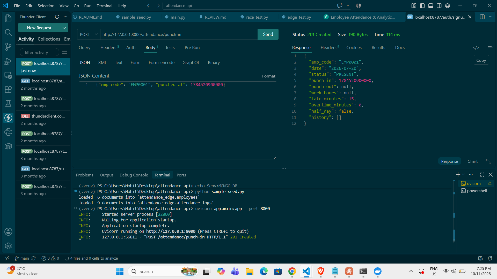
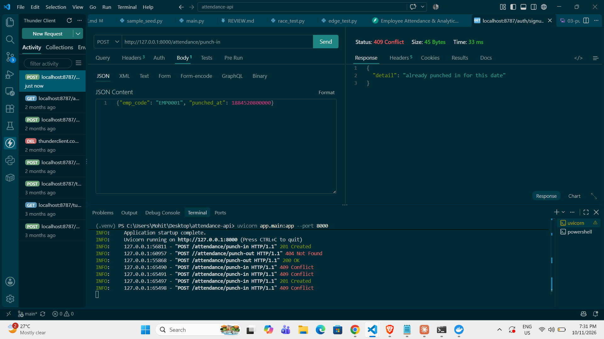
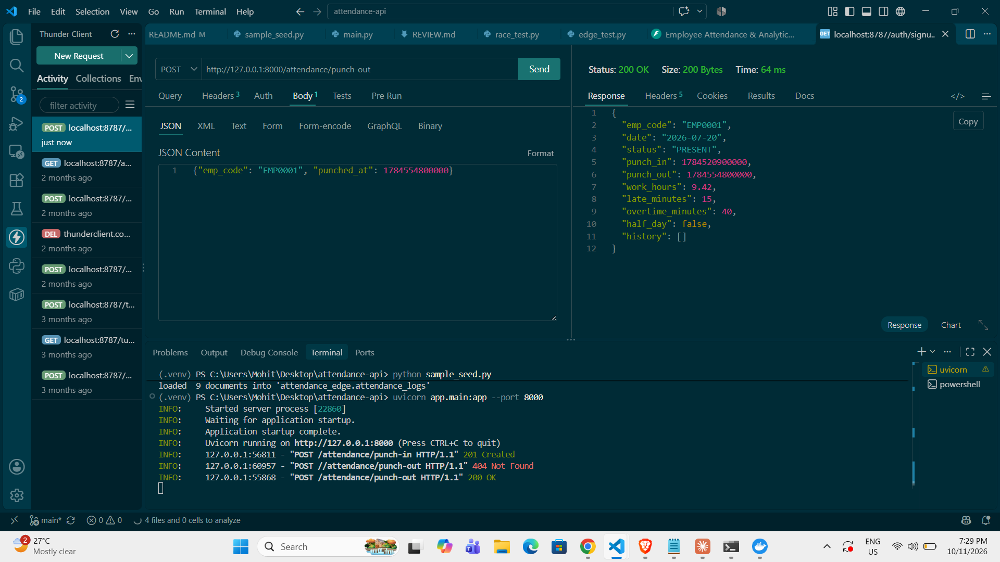
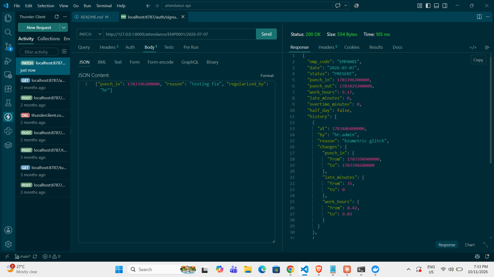
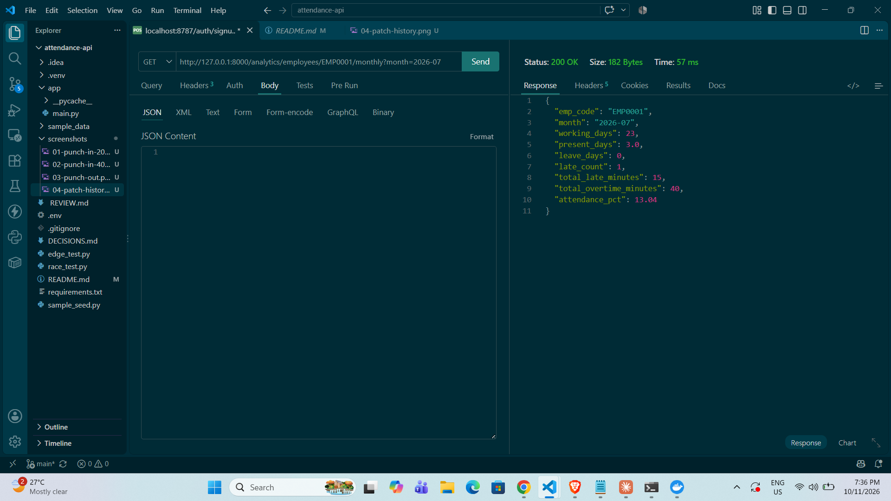
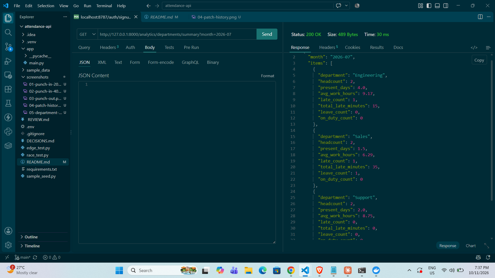
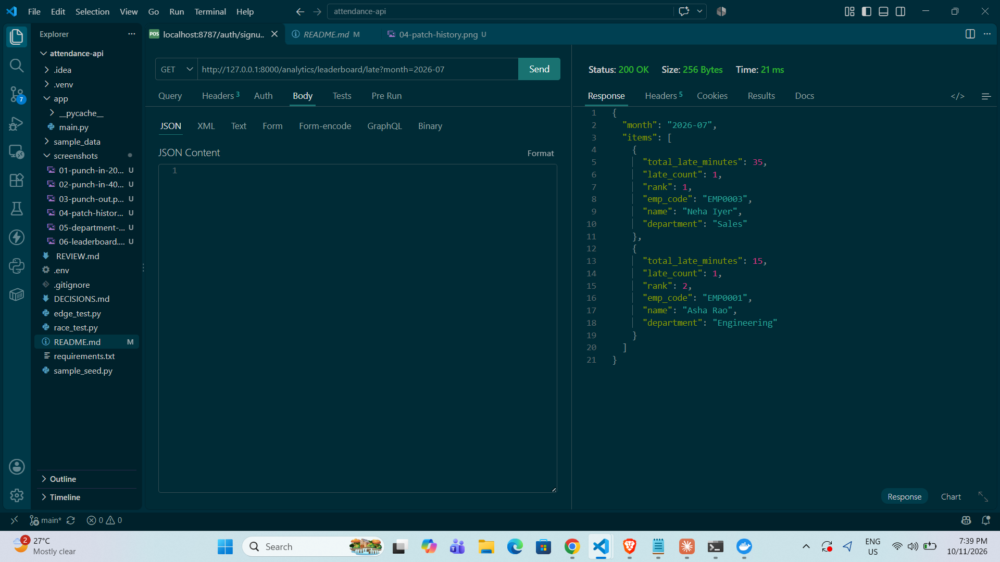
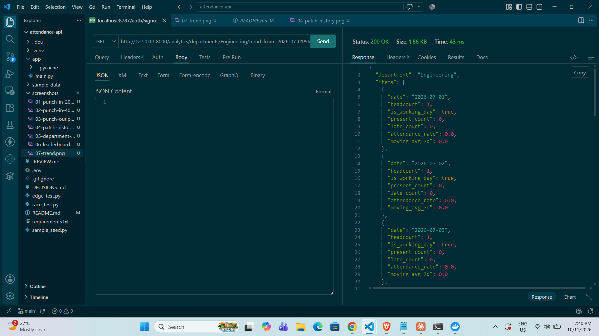
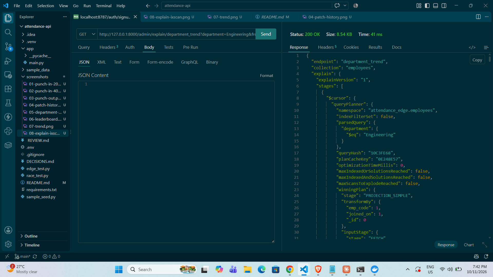
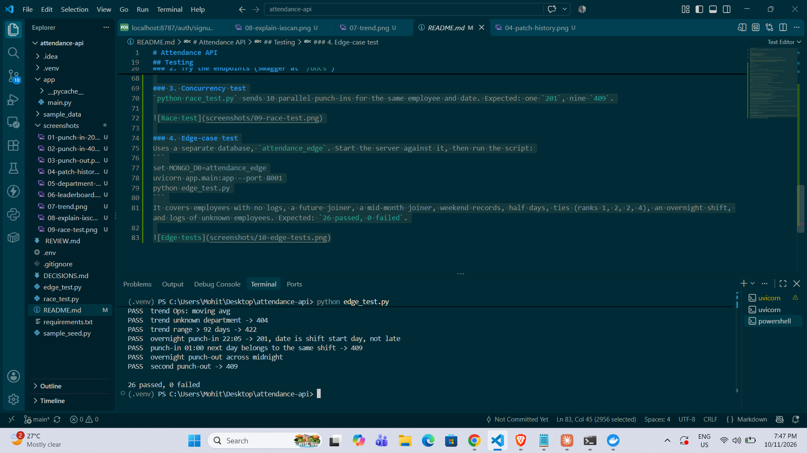

# Attendance API

FastAPI + MongoDB. All application code is in `app/main.py`.

## Run
```
pip install -r requirements.txt
set MONGO_URI=mongodb://localhost:27017
set MONGO_DB=attendance_db
uvicorn app.main:app --port 8000
```
Indexes are created at startup. Interactive docs: `http://127.0.0.1:8000/docs`.

## Notes
- `moving_avg_7d` averages the already-rounded (4 decimals) `attendance_rate` values.
- The trend series is generated with `$range` inside the pipeline (no Python loop).
- Everything in the contract is implemented; nothing is missing.

## Testing

### 1. Load the sample data
```
python sample_seed.py
```

### 2. Try the endpoints (Swagger at `/docs`)

**Punch-in** `POST /attendance/punch-in` (09:45 IST on 2026-07-20, 15 minutes late)
```json

{"emp_code": "EMP0001", "punched_at": 1784520900000}
```
Expected: `201`, `late_minutes: 15`. Sending it again returns `409`.




**Punch-out** `POST /attendance/punch-out` (19:10 IST)
```json
{"emp_code": "EMP0001", "punched_at": 1784554800000}
```
Expected: `200`, `work_hours: 9.42`, `overtime_minutes: 40`, `half_day: false`.



**Regularize** `PATCH /attendance/EMP0001/2026-07-07`
```json
{"punch_in": 1783396200000, "reason": "testing fix", "regularized_by": "hr"}
```
Expected: `200`, one new `history` entry with `punch_in` and `work_hours` in `changes`. The same request again returns `422` (nothing changes).



**Analytics** (month `2026-07`)
- `GET /analytics/employees/EMP0001/monthly?month=2026-07`
- `GET /analytics/departments/summary?month=2026-07`
- `GET /analytics/leaderboard/late?month=2026-07`
- `GET /analytics/departments/Engineering/trend?from=2026-07-01&to=2026-07-14`





**Explain** `GET /admin/explain/department_trend?department=Engineering&from=2026-07-01&to=2026-07-14`
The plan shows `IXSCAN` and no `COLLSCAN`.



### 3. Concurrency test
`python race_test.py` sends 10 parallel punch-ins for the same employee and date. Expected: one `201`, nine `409`.



### 4. Edge-case test
Uses a separate database, `attendance_edge`. Start the server against it, then run the script:
```
set MONGO_DB=attendance_edge
uvicorn app.main:app --port 8001
python edge_test.py
```
It covers employees with no logs, a future joiner, a mid-month joiner, weekend records, half days, ties (ranks 1, 2, 2, 4), an overnight shift, and logs of unknown employees. Expected: `26 passed, 0 failed`.

